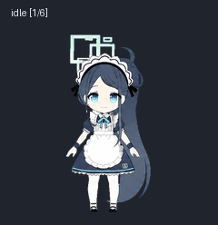

# Petex — 天童爱丽丝（女仆）定制版 (Tendou Arisu Maid Edition) 💙

> **Upstream Attribution / 上游项目致谢**
> 本项目基于 [**iebb/petex**](https://github.com/iebb/petex)（v1.1.21，Apache-2.0 协议）深度定制开发。感谢原作者 [@iebb](https://github.com/iebb) 提供轻量化、优雅的跨平台 Electron 桌宠框架。

## v2.0.0：女仆清扫大作战

爱丽丝学会了擦屏幕和向左右拖地，挥手、张望、伤心和站立摸头也换了新动作。设置里现在可以分别调节 11 项随机动作的权重、单独关闭随机动作的气泡，并把桌宠放大到 320 px。

- [下载 Windows x64 便携版](https://github.com/aris477/petex-arisu-maid/releases/tag/v2.0.0)：解压到新目录，双击 `Start-Petex-Aris.cmd`，爱丽丝已经预置。
- [历史更新](#历史更新) · [完整更新日志](CHANGELOG.md) · [使用、升级与源码运行说明](docs/v2.0.0.md)

下方动图展示早期版本的基本玩法。

<p align="center">
  
</p>

<p align="center">
  
  &nbsp;&nbsp;&nbsp;
  
</p>

---

## ✨ 相比上游原版的核心改动与新增特性

### 1. 专属天童爱丽丝（女仆）游戏机天蓝聊天气泡 (`app/renderer/pet.html`, `pet.css`, `pet.js`)
- **定制视觉元素**：
  - **左上角**：`-28°` 倾斜掌机贴纸（深海蓝机身、发光青色屏幕、十字键与四色按键）；
  - **右上角**：天童爱丽丝标志性的 **4 矩形交错几何光环（Halo）** + 双层高光天蓝爱心 + 四芒星闪光；
  - **右下角**：精准还原《蔚蓝档案》爱用品 T2 **「女仆发带」**（连续纯白钝角五边形折边、深炭灰内轮廓、淡蓝紫布料暗部折影、纯黑发卡骨架与双侧黑色蝴蝶结）；
  - **气泡主体**：`#d8f3ff → #eefbff → #d4f1ff` 天蓝色高光渐变底色 + 机能风内折角线（HUD Corner Brackets）；特殊状态（任务完成 / 收到委托 / 好感度 UP）自动贴出微倾胶囊角标，日常对话保持干净无顶栏。
- **随动与鼠标穿透**：普通气泡内嵌于桌宠透明窗口顶部的 `164px` 净空区；贴边时切换到独立透明气泡窗口，保留装饰和字号并随角色轮廓移动。气泡区域鼠标穿透。
- **动作绑定 RPG 台词池**：左键点击、长按跳跃、右键菜单动作及摸头互动均内置符合爱丽丝（游戏开发部 + 女仆勇者）人设的多套台词，并支持防连续重复抽取。

### 2. Codex 任务状态实时监听与自动弹窗 (`app/main.cjs`)
- **会话流增量监听**：主进程后台以 `1.2s` 间隔增量读取 `~/.codex/sessions/YYYY/MM/DD/rollout-*.jsonl` 最新字节（按完整换行符对齐防半行截断）：
  - **收到新任务 (`task_started`)**：自动切换忙碌动作并弹出「收到委托」气泡；
  - **任务完成 (`task_complete`)**：自动触发欢呼跳跃动作，弹出蔚蓝档案星光天蓝/宝蓝高亮的「任务完成 💙 · 耗时 Xs」气泡，并自动提取本轮回复首行摘要；
  - **任务中止 (`turn_aborted`)**：自动弹出任务中止待命提示。
- **外部脚本即时通知 (`data/notify.json`)**：任意外部脚本或构建工具只需向 `data/notify.json` 写入 JSON，即可随时触发桌宠弹窗与动作。

### 3. 免按键「摸头」互动与交互增强 (`app/renderer/pet.js`, `app/desktop.cjs`, `app/settings.js`)
- **自然摸头触发**：把鼠标移到爱丽丝头顶，左右来回滑动，不用按键。v2.0.0 用专属站立摸头动画回应并弹出「好感度 UP」气泡；也能从右键菜单选择「摸头」。
- **左键随机动作与全动作右键菜单**：
  - 新增 `clickAction` 配置（支持指定动作或 `random` 随机动作），顶部设置下拉框切换即存；
  - 桌面右键菜单可播放当前角色支持的动作，也有随机台词与任务完成提示的测试入口；
  - 水平拖拽移动桌宠时自动播放左右奔跑动画。

### 4. 原生 2× HD 高清图集引擎与零残影视线追踪 (`app/library.cjs`, `app/renderer/sprite.js`)
- **2× HD (`3072×4576` / 单格 `384×416`) 原生支持**：扩展图集尺寸校验器与 Canvas 1:1 高清采样，告别 1× 图集放大模糊。
- **零双影 60 FPS 视线追踪**：废除会产生半透明叠影的相邻帧 Alpha 混合，改用 **60 FPS 平滑角度追赶 + `±3.5°` 扇区边界滞回防抖（Hysteresis） + `±1.5px` 扇区内微倾位移**，既丝滑又保证每一帧 100% 锐利无重影。
- **动作节奏优化**：全面调优 9 组动作单帧时长，支持单次触发连播 2–3 轮。

### 5. AI 补帧：5 组动作插入 RIFE 生成的真实中间帧 (`app/renderer/sprite.js`, `pets/arisu-maid-hd-2x/spritesheet.webp`)

这段记录的是早期主图集的补帧方案。v2.0.0 的高清角色优先使用新版独立动作图集，缺图时的回退方式见 [v2.0.0 说明](docs/v2.0.0.md)。

利用每行动画末尾**原本就空着**的列存放 AI 生成的中间帧，图集尺寸仍是 `3072×4576`、8 列不变，因此尺寸校验器与打包流程都无需改动。

| 动作 | 帧数 | 插入的中间帧 |
| :--- | :--- | :--- |
| 待机 idle | 6 → 8 | 0→1、5→0 |
| 挥手 waving | 4 → 6 | 2→3、3→0 |
| 等待 waiting | 6 → 8 | 4→5、5→0 |
| 忙碌 running | 6 → 8 | 0→1、5→0 |
| 思考 review | 6 → 8 | 2→3、5→0 |

- **总时长严格不变**：中间帧的停留时间从相邻原帧里对半拆出，原帧节奏完全不动。例：待机 `[600,160,160,200,200,680]` → 拆成 `[300,300,160,160,200,200,340,340]`。
- **显式帧序列**：`ANIMATIONS` 新增 `frames` 字段，明确指定每一步读图集哪一列，因此"原帧 + 中间帧"可以按任意顺序播放；`durations` 与 `frames` 平行。没有 `frames` 的动作仍按列号顺序播放，向后兼容。
- **空白列自动回退**：`pets/arisu-maid-1x/` 未补帧，其空列在新代码下会播成空白。启动时会测量每格内容，遇到空列自动回退显示上一张原帧（拆分时长恰好加回原停留时间），因此同一份代码配 1× / 2× 图集都不会闪白帧。
- **遮挡重影处理**：等待动作 4→5 这一帧存在领结与手部的遮挡重影，未采用叠帧淡化，而是按"运动中"处理——对双手臂做定向运动虚化，使双重轮廓变成运动拖影。

**未补帧的动作**：跳跃、伤心、左右跑。这三类的中间帧经逐帧目视确认为双重轮廓或糊脸，故排除；伤心与两行视线也已排满 8 列，没有空列可用。

### 6. Windows 高分屏窗口防放大与 Codex 伴生守护进程 (`app/desktop.cjs`, `companion/CodexPetCompanion.cs`)- **高分屏拖拽防变形**：将所有 `win.setPosition` 替换为显式锁定 `winW × winH` 的 `win.setBounds`，彻底根治 Windows 125%/150%/200% DPI 缩放下拖拽桌宠导致窗口越拖越大、比例失调的 Electron 经典 Bug。
- **Codex 伴生启动器 (`CodexPetCompanion.cs`)**：
  - 自动监听官方 Codex 桌面端进程，Codex 启动时自动拉起桌宠，Codex 退出 15 秒后自动收起桌宠；
  - 显式指定 `lpDesktop = "Winsta0\\Default"`，支持直接从 Codex 沙箱（`CodexSandboxDesktop-*`）将可见桌宠窗口拉起到主桌面。

---

## 历史更新

### v2.0.0 后续源码更新：大小适配与缩边摸头（2026-11-25）

- **桌宠大小上限提高到 520 px**：在「设置 → 大小」调整。工作区放不下时会临时缩小，给气泡留出空间；空间恢复后按保存的大小显示。
- **恢复缩边摸头的轻晃**：爱丽丝缩在任一屏幕边缘时，摸头会轻晃并显示好感度气泡，拖离边缘时停止轻晃。站立时仍播放《摸头3》V4，无额外摇晃。

两项改动已同步到 `main` 源码。下方 v2.0.0 的便携下载包是 11 月 24 日的原发布版。[完整更新日志](CHANGELOG.md)

### v2.0.0：女仆清扫大作战（2026-11-24）

- **新增动作**：擦屏幕、向左拖地和向右拖地。擦拭与收尾各有一句气泡，拖地起步随机说一句，接近边缘会提前收步。
- **动作重做与修正**：更新挥手、张望、伤心和站立摸头，细调待机、视线跟随、等待、跳跃、忙碌和向左走。
- **新增设置**：11 项随机动作可分别调权重，自动动作气泡可单独关闭，显示大小上限提高到 320 px。

[v2.0.0 发布与下载](https://github.com/aris477/petex-arisu-maid/releases/tag/v2.0.0) · [v2.0.0 完整更新日志](CHANGELOG.md#v200--女仆清扫大作战--2026-11-24)

### v1.3.0：屏幕边缘大冒险（2026-11-15）

爱丽丝现在可以藏到屏幕左、右、上、下四条边：拖到边缘后缩回，鼠标靠近她时探头，也可以设置定时探头。四个方向使用各自的原画和动作，没有用镜像代替。

- **四边动作与定位**：每方向 32 帧，45ms/帧，0.75 倍边缘缩放；支持拖离衔接、角落方向锁定和原生窗口边缘对齐。最终 v3.3 图集保留光环、头发与眼睛精修。
- **原样式贴边气泡**：独立透明、鼠标穿透气泡窗口，保留掌机、光环爱心和女仆发箍装饰。上下沿随探头/缩回移动，行程上限按大小缩放，最大 100 DIP，并按当前角色轮廓限位。
- **25 句、六组贴边台词**：入边、探头、久待、点击唤出、甩入和夜间。定时探头也会说话；入边台词播放完再接探头台词，任务消息优先并可恢复待播台词。
- **按完整静置时间探头**：从实际缩回结束与气泡消失两者较晚的时刻开始等待；鼠标感应只覆盖角色附近，远处同一条边不会一直把她留在外面。
- **设置可调**：开启/关闭贴边、靠近探头；定时探头可选关闭、8/15/30 秒；久待台词可设 0–120 分钟，0 为关闭，默认 12 分钟。
- **当时的贴边摸头**：探头时可左右轻晃鼠标摸头。v2.0.0 高清角色贴边时保留「好感度 UP」气泡和贴边画面；站立时才播放新摸头动作。

完整使用方法、图集规格和验证边界见 [四边贴靠说明](docs/screen-edge-update.md)。可复现的几何、计时、感应区和久待测试：

```powershell
node tests/edge/run.cjs
```

本轮接入的是文字台词；介绍视频中的角色原声和配乐没有作为桌宠运行时语音加入。

---

## 📁 仓库目录结构

```text
petex-arisu-maid/
├── app/                          # 定制版 Petex 核心源码 (解包自 resources/app.asar)
│   ├── main.cjs                  # 主进程：IPC、右键菜单、Codex 会话 JSONL 实时监听器
│   ├── desktop.cjs               # 桌面窗口管理：高分屏 setBounds 锁定、164px 顶部气泡净空区
│   ├── library.cjs               # 图集库：支持 3072×4576 (2× HD) 与 clickAction 配置
│   ├── preload.cjs               # 预加载桥：暴露 onSpeech 等安全 IPC 通道
│   └── renderer/
│       ├── pet.html              # 桌宠渲染层：掌机、4 矩形光环、蓝色爱心、女仆发箍 SVG 气泡
│       ├── pet.css               # 天蓝高光渐变气泡样式、机能折角线、浮动状态角标动画
│       ├── pet.js                # 爱丽丝 RPG 台词池、免按键摸头识别、气泡状态机
│       ├── sprite.js             # 2× HD 渲染器、无残影滞回视线追踪、多轮动作帧时序、AI 补帧序列
│       └── settings.js           # 设置面板：支持「随机动作」clickAction 选择与预览
├── pets/                         # 天童爱丽丝（女仆）v2 桌宠图集资源
│   ├── arisu-maid-hd-2x/         # 3072×4576 (单格 384×416) 2× HD 超清 WebP 图集与 pet.json
│   ├── arisu-maid-1x/            # 1536×2288 (单格 192×208) 标准 1× 图集与 pet.json
│   └── preview/                  # 动作与 16 方向视线追踪预览 GIF
├── companion/                    # Windows 伴随 Codex 启动守护进程与脚本
│   ├── CodexPetCompanion.cs      # C# 守护进程源码 (支持跨沙箱 Winsta0\Default 桌面拉起)
│   ├── Enable-CodexPetStartup.ps1
│   └── Disable-CodexPetStartup.ps1
└── scripts/                      # 便携版 ASAR 免编译热补丁脚本
    ├── apply_speech_bubble.py    # 一键重打包 app.asar 并自动更新 Petex.exe 内置 SHA-256
    └── apply_no_ghost_and_timing.py
```

---

## 🚀 快速使用方式

### 方式一：Windows 便携版

从 [v2.0.0 发布页](https://github.com/aris477/petex-arisu-maid/releases/tag/v2.0.0) 下载 ZIP，完整解压后双击 `Start-Petex-Aris.cmd`。已有便携版的用户请看 [设置迁移说明](docs/v2.0.0.md#从旧版迁移设置)。

### 方式二：从源码直接运行
见 [源码运行说明](docs/v2.0.0.md#从源码运行)，包含完整角色图集的配置方法。

### 方式三：外部脚本触发自定义「任务完成」弹窗
向数据目录下的 `data/notify.json` 写入 JSON 即可立即驱动爱丽丝欢呼跳跃并弹出提示气泡：
```json
{
  "kind": "done",
  "badge": "任务完成 💙",
  "meta": "耗时 8s",
  "text": "邦邦咔邦～！老师的构建任务已经顺利完成啦！",
  "action": "jumping",
  "duration": 7500
}
```

---

## 📜 开源协议与致谢 (License & Credits)
- **框架代码协议**：遵循上游项目的 [Apache License 2.0](LICENSE)。
- **上游项目**：[https://github.com/iebb/petex](https://github.com/iebb/petex) (`Copyright 2026 iebb`)。
- **角色设定致谢**：天童爱丽丝（女仆 / Tendou Arisu Maid）角色形象源自《蔚蓝档案》(Blue Archive / NEXON Games & Yostar)，本仓库角色素材和文字台词供桌面爱好者学习与非商业交流。
