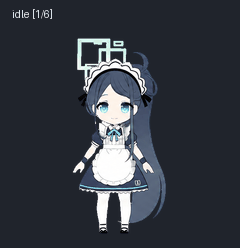

# Petex — 天童爱丽丝（女仆）定制版 (Tendou Arisu Maid Edition) 💙

> **Upstream Attribution / 上游项目致谢**
> 本项目基于 [**iebb/petex**](https://github.com/iebb/petex)（v1.1.21，Apache-2.0 协议）深度定制开发。感谢原作者 [@iebb](https://github.com/iebb) 提供轻量化、优雅的跨平台 Electron 桌宠框架。

<p align="center">
  
</p>

<p align="center">
  
  &nbsp;&nbsp;&nbsp;
  
</p>

---

## ✨ 相比上游原版的核心改动与新增特性

### 1. 专属天童爱丽丝（女仆）游戏机天蓝聊天气泡 (`app/renderer/pet.html`, `pet.css`, `pet.js`)
- **定制视觉元素**：
  - **左上角**：`-28°` 倾斜掌机贴纸（深海蓝机身、发光青色屏幕、十字键与四色按键）；
  - **右上角**：天童爱丽丝标志性的 **4 矩形交错几何光环（Halo）** + 双层高光天蓝爱心 + 四芒星闪光；
  - **右下角**：精准还原《蔚蓝档案》爱用品 T2 **「女仆发带」**（连续纯白钝角五边形折边、深炭灰内轮廓、淡蓝紫布料暗部折影、纯黑发卡骨架与双侧黑色蝴蝶结）；
  - **气泡主体**：`#d8f3ff → #eefbff → #d4f1ff` 天蓝色高光渐变底色 + 机能风内折角线（HUD Corner Brackets）；特殊状态（任务完成 / 收到委托 / 好感度 UP）自动贴出微倾胶囊角标，日常对话保持干净无顶栏。
- **60 FPS 同步与 100% 鼠标穿透**：气泡直接内嵌于桌宠透明窗口顶部预留的 `164px` 净空区内，随桌宠拖拽与行走零延迟同步移动；碰撞检测严格绑定角色像素，气泡区域完全鼠标穿透，绝不遮挡桌面点击。
- **动作绑定 RPG 台词池**：左键点击、长按跳跃、右键菜单动作及摸头互动均内置符合爱丽丝（游戏开发部 + 女仆勇者）人设的多套台词，并支持防连续重复抽取。

### 2. Codex 任务状态实时监听与自动弹窗 (`app/main.cjs`)
- **会话流增量监听**：主进程后台以 `1.2s` 间隔增量读取 `~/.codex/sessions/YYYY/MM/DD/rollout-*.jsonl` 最新字节（按完整换行符对齐防半行截断）：
  - **收到新任务 (`task_started`)**：自动切换忙碌动作并弹出「收到委托」气泡；
  - **任务完成 (`task_complete`)**：自动触发欢呼跳跃动作，弹出蔚蓝档案星光天蓝/宝蓝高亮的「任务完成 💙 · 耗时 Xs」气泡，并自动提取本轮回复首行摘要；
  - **任务中止 (`turn_aborted`)**：自动弹出任务中止待命提示。
- **外部脚本即时通知 (`data/notify.json`)**：任意外部脚本或构建工具只需向 `data/notify.json` 写入 JSON，即可随时触发桌宠弹窗与动作。

### 3. 免按键「摸头」互动与交互增强 (`app/renderer/pet.js`, `app/desktop.cjs`, `app/settings.js`)
- **自然摸头触发**：无需按住 `Shift` 或手动开启隐藏设置，直接将鼠标移至爱丽丝头顶区域左右轻晃 3 下，即可触发开心晃动 + 挥手动画与「好感度 UP 💙」专属台词气泡（冷却缩短至 2.5s）。
- **左键随机动作与全动作右键菜单**：
  - 新增 `clickAction` 配置（支持指定动作或 `random` 随机动作），顶部设置下拉框切换即存；
  - 桌面右键菜单新增「💬 随机台词气泡」、「🎉 测试任务完成提示」及完整 8 动作快捷触发项；
  - 水平拖拽移动桌宠时自动播放左右奔跑动画。

### 4. 原生 2× HD 高清图集引擎与零残影视线追踪 (`app/library.cjs`, `app/renderer/sprite.js`)
- **2× HD (`3072×4576` / 单格 `384×416`) 原生支持**：扩展图集尺寸校验器与 Canvas 1:1 高清采样，告别 1× 图集放大模糊。
- **零双影 60 FPS 视线追踪**：废除会产生半透明叠影的相邻帧 Alpha 混合，改用 **60 FPS 平滑角度追赶 + `±3.5°` 扇区边界滞回防抖（Hysteresis） + `±1.5px` 扇区内微倾位移**，既丝滑又保证每一帧 100% 锐利无重影。
- **动作节奏优化**：全面调优 9 组动作单帧时长，支持单次触发连播 2–3 轮。

### 5. Windows 高分屏窗口防放大与 Codex 伴生守护进程 (`app/desktop.cjs`, `companion/CodexPetCompanion.cs`)
- **高分屏拖拽防变形**：将所有 `win.setPosition` 替换为显式锁定 `winW × winH` 的 `win.setBounds`，彻底根治 Windows 125%/150%/200% DPI 缩放下拖拽桌宠导致窗口越拖越大、比例失调的 Electron 经典 Bug。
- **Codex 伴生启动器 (`CodexPetCompanion.cs`)**：
  - 自动监听官方 Codex 桌面端进程，Codex 启动时自动拉起桌宠，Codex 退出 15 秒后自动收起桌宠；
  - 显式指定 `lpDesktop = "Winsta0\\Default"`，支持直接从 Codex 沙箱（`CodexSandboxDesktop-*`）将可见桌宠窗口拉起到主桌面。

---

## 📁 仓库目录结构

```text
petex-arisu-maid/
├── app/                          # 定制版 Petex 核心源码 (解包自 resources/app.asar)
│   ├── main.cjs                  # 主进程：IPC、右键菜单、Codex 会话 JSONL 实时监听器
│   ├── desktop.cjs               # 桌面窗口管理：高分屏 setBounds 锁定、164px 顶部气泡净空区
│   ├── library.cjs               # 图集库：支持 3072×4576 (2× HD) 与 clickAction 配置
│   ├── preload.cjs               # 预加载桥：暴露 onSpeech 等安全 IPC 通道
│   └── renderer/
│       ├── pet.html              # 桌宠渲染层：掌机、4 矩形光环、蓝色爱心、女仆发箍 SVG 气泡
│       ├── pet.css               # 天蓝高光渐变气泡样式、机能折角线、浮动状态角标动画
│       ├── pet.js                # 爱丽丝 RPG 台词池、免按键摸头识别、气泡状态机
│       ├── sprite.js             # 2× HD 渲染器、无残影滞回视线追踪、多轮动作帧时序
│       └── settings.js           # 设置面板：支持「随机动作」clickAction 选择与预览
├── pets/                         # 天童爱丽丝（女仆）v2 桌宠图集资源
│   ├── arisu-maid-hd-2x/         # 3072×4576 (单格 384×416) 2× HD 超清 WebP 图集与 pet.json
│   ├── arisu-maid-1x/            # 1536×2288 (单格 192×208) 标准 1× 图集与 pet.json
│   └── preview/                  # 动作与 16 方向视线追踪预览 GIF
├── companion/                    # Windows 伴随 Codex 启动守护进程与脚本
│   ├── CodexPetCompanion.cs      # C# 守护进程源码 (支持跨沙箱 Winsta0\Default 桌面拉起)
│   ├── Enable-CodexPetStartup.ps1
│   └── Disable-CodexPetStartup.ps1
└── scripts/                      # 便携版 ASAR 免编译热补丁脚本
    ├── apply_speech_bubble.py    # 一键重打包 app.asar 并自动更新 Petex.exe 内置 SHA-256
    └── apply_no_ghost_and_timing.py
```

---

## 🚀 快速使用方式

### 方式一：基于官方 Petex 便携版一键打补丁（推荐，免安装 Node/C++ 编译环境）
1. 下载上游官方发行版 [Petex v1.1.21 Windows](https://github.com/iebb/petex/releases) 并解压至本地目录；
2. 将 `pets/arisu-maid-hd-2x/` 导入或放入 `data/pets/` 目录；
3. 修改 `scripts/apply_speech_bubble.py` 中的 `portable` 路径指向你的 `Petex` 目录并运行：
   ```powershell
   python scripts/apply_speech_bubble.py
   ```
   脚本会自动将全部定制源码重打包进 `resources/app.asar`，并自动计算新的 Header SHA-256 写回 `Petex.exe` 以通过 Electron 完整性校验。

### 方式二：从源码直接运行
```powershell
npm install
npx electron .
```

### 方式三：外部脚本触发自定义「任务完成」弹窗
向数据目录下的 `data/notify.json` 写入 JSON 即可立即驱动爱丽丝欢呼跳跃并弹出提示气泡：
```json
{
  "kind": "done",
  "badge": "任务完成 💙",
  "meta": "耗时 8s",
  "text": "邦邦咔邦～！老师的构建任务已经顺利完成啦！",
  "action": "jumping",
  "duration": 7500
}
```

---

## 📜 开源协议与致谢 (License & Credits)
- **框架代码协议**：遵循上游项目的 [Apache License 2.0](LICENSE)。
- **上游项目**：[https://github.com/iebb/petex](https://github.com/iebb/petex) (`Copyright 2026 iebb`)。
- **角色设定致谢**：天童爱丽丝（女仆 / Tendou Arisu Maid）角色形象源自《蔚蓝档案》(Blue Archive / NEXON Games & Yostar)，本仓库图集与语音台词仅作个人桌面爱好者学习与非商业交流展示。
